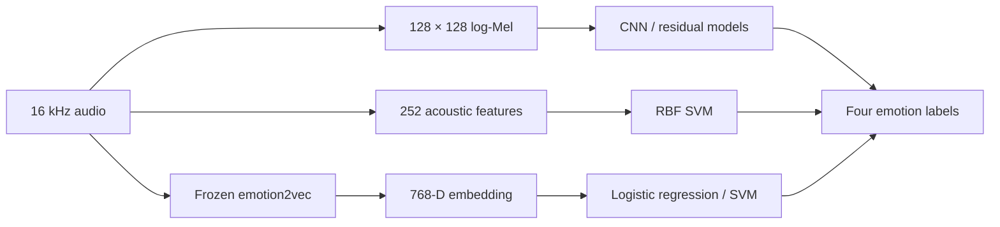

# Speech Emotion Recognition

**Speaker-independent experiments with residual networks and pretrained speech representations.**


[](https://colab.research.google.com/github/nzrnaghme/RealTime-SER-ResNet/blob/main/SER_v10_Colab.ipynb)

[Overview](#overview) · [Results](#recorded-results) · [Quick start](#quick-start) · [emotion2vec](#emotion2vec-workflow) · [Repository guide](#repository-guide) · [فارسی](README_FA.md)

## Overview

This project studies four-class speech emotion recognition on **RAVDESS** and **TESS**, with a focus on how models perform on speakers excluded from training. It compares compact convolutional and residual networks with an acoustic SVM and frozen **emotion2vec** representations under an explicit evaluation protocol.

The implementation accompanies the research manuscript *Speaker Independent Speech Emotion Recognition with Residual and Pretrained Models*. Its contribution is a controlled experimental comparison, including negative results and deployment measurements; the underlying learning methods are established.

The code provides:

- **Speaker-disjoint evaluation:** explicit training, validation, and test partitions, with duplicate detection and training-only normalization.
- **Controlled model comparisons:** matched CNN/residual models, gradient-clipping and learning-rate-scheduling ablations, and three training seeds.
- **Complementary baselines:** 252 acoustic descriptors with an RBF SVM, and frozen emotion2vec embeddings with logistic-regression or SVM heads.
- **Practical inference:** command-line prediction, a Tk desktop interface, and CPU benchmarking for complete audio files.

The four output labels are **Neutral · Happy · Sad · Angry**. The historical repository name, `RealTime-SER-ResNet`, is retained; the implemented inference workflow analyzes a complete recording. Streaming and microphone-to-first-prediction latency have not been established.

> **Source release:** this repository includes code, dependency lists, and an output-free notebook. Download the official datasets and generate model artifacts locally. Trained weights, feature caches, recorded predictions, and archived experiment metadata are not included here. See [release notes](PUBLICATION_NOTES.md).

## Processing pipeline



Compact neural models share the same learned layers and **101,332 total parameters**; the residual variant adds identity shortcuts. Model selection uses validation UAR. Test data are reserved for evaluation after the comparison is frozen.

## Recorded results

The following results come from the archived v10 experiment on a fixed **912-recording, speaker-disjoint test partition**. They are reported for context; cloning the source does not download the artifacts needed to replay that exact run. All scores are percentages.

| Model | Accuracy | UAR | Macro-F1 | Corpus-balanced UAR |
|---|---:|---:|---:|---:|
| Acoustic SVM | **69.30** | **69.58** | 63.89 | 66.95 |
| emotion2vec + logistic regression | 63.49 | 63.63 | 61.63 | 71.52 |
| **emotion2vec + RBF SVM** | 67.87 | 68.17 | **64.42** | **72.50** |

**UAR** is mean recall across the four classes. **Corpus-balanced UAR** gives equal weight to RAVDESS UAR and TESS UAR.

Validation selected emotion2vec + RBF SVM with `C = 1`. Compared with the acoustic SVM, its corpus-balanced UAR increases by **5.55 percentage points**, while pooled accuracy decreases by **1.43 points**. Residual connections and optimization controls showed no consistent advantage in the matched compact-model experiments.

A substantial remaining failure is **3.50% Angry recall on the held-out TESS speaker**. The earlier manuscript's 74.4% accuracy used a different evaluation protocol and is not a directly comparable baseline. These findings motivate reporting both pooled and per-corpus performance.

## Quick start

### 1. Set up the environment

Use **Python 3.12**. Run commands from the repository root in Bash; on Windows, use WSL/Git Bash or adapt activation and multiline commands for PowerShell.

```bash
git clone https://github.com/nzrnaghme/RealTime-SER-ResNet.git
cd RealTime-SER-ResNet

python3.12 -m venv .venv
source .venv/bin/activate
python -m pip install -r requirements.txt
python -m pip check
```

The compact pipeline and emotion2vec use separate pinned environments. A GPU is not required by these examples. The desktop interface additionally requires Tkinter and a graphical desktop.

### 2. Prepare the official datasets

| Dataset | Official source | Local audio directory |
|---|---|---|
| RAVDESS | [Audio-only speech recordings](https://zenodo.org/records/1188976) | `data/RAVDESS` |
| TESS | [Toronto emotional speech set](https://doi.org/10.5683/SP2/E8H2MF) | `data/TESS` |

Download and extract the original recordings, respecting their licenses. The extractor searches the supplied directories recursively. Avoid previously augmented or merged datasets when following this protocol.

```bash
python ser_data_v10.py \
  --ravdess data/RAVDESS \
  --tess data/TESS \
  --out runs/new_features \
  --workers 2
```

This produces the manifest, split counts, feature metadata, and feature cache for your local data. The archived experiment contained **2,271 unique recordings** after removing one exact RAVDESS duplicate:

| Partition | RAVDESS speakers | TESS speaker | Total recordings |
|---|---|---|---:|
| Training | Actors 01–16 | YAF | 1,247 |
| Validation | Actors 17–20 | — | 112 |
| Test | Actors 21–24 | OAF | 912 |

TESS has only two speakers, so this three-way speaker split has no TESS validation speaker. Words and sentences are not held out independently.

### 3. Train the primary comparisons

```bash
python ser_models_v10.py train \
  --features runs/new_features/features.npz \
  --manifest runs/new_features/manifest.csv \
  --output runs/new_foldA \
  --models svm cnn r0 r1 r2 r3 \
  --seeds 17 42 73 \
  --epochs 25
```

| Configuration | Residual connections | Gradient clipping | LR scheduling |
|---|:---:|:---:|:---:|
| `cnn` | — | — | — |
| `r0` | ✓ | — | — |
| `r1` | ✓ | ✓ | — |
| `r2` | ✓ | — | ✓ |
| `r3` | ✓ | ✓ | ✓ |

`svm` runs the acoustic baseline. The separate `ser_models_regularized_v10.py` script adds feature masking and dropout and exposes the same `train`, `freeze`, and `evaluate` interface. Use a separate output directory for that experiment.

### 4. Freeze selections and evaluate

Review validation results and finish configuration choices before evaluating the held-out test set.

```bash
python ser_models_v10.py freeze --output runs/new_foldA

python ser_models_v10.py evaluate \
  --features runs/new_features/features.npz \
  --manifest runs/new_features/manifest.csv \
  --output runs/new_foldA
```

Use a fresh output directory for each new experiment. A frozen campaign cannot be retrained in place. Further tuning informed by test results requires an independent evaluation.

### 5. Predict from an audio file

After training the acoustic SVM above:

```bash
python ser_infer.py recording.wav \
  --model runs/new_foldA/svm/best.joblib \
  --feature-metadata runs/new_features/feature_metadata.json \
  --output prediction.json
```

To launch the desktop interface:

```bash
python ser_demo.py \
  --model runs/new_foldA/svm/best.joblib \
  --metadata runs/new_features/feature_metadata.json
```

For neural inference, pass the generated `best.keras` checkpoint and preserve its neighboring normalizer, configuration, and result files. SVM decision values are not probabilities; softmax and logistic scores are not calibrated confidence or measured accuracy.

## emotion2vec workflow

The pretrained branch uses the **original emotion2vec base** encoder. The downloader pins its revision and checksums; the external checkpoint is approximately **1.126 GB**. Use a separate environment from the compact pipeline.

<details>
<summary><strong>Installation, feature extraction, and head training</strong></summary>

Open a fresh shell at the repository root, then run:

```bash
python3.12 -m venv .venv-emotion2vec
source .venv-emotion2vec/bin/activate
python -m pip install torch==2.8.0 torchaudio==2.8.0 --index-url https://download.pytorch.org/whl/cpu
python -m pip install -r requirements_emotion2vec.txt
python -m pip check

python download_emotion2vec.py --output emotion2vec_base

python ser_data_v10.py \
  --ravdess data/RAVDESS --tess data/TESS \
  --out runs/emotion2vec_inventory --inventory-only

python emotion2vec_baseline_v10.py extract \
  --model emotion2vec_base \
  --manifest runs/emotion2vec_inventory/manifest.csv \
  --out runs/new_emotion2vec_features.npz --threads 2

python emotion2vec_baseline_v10.py fit \
  --manifest runs/emotion2vec_inventory/manifest.csv \
  --features runs/new_emotion2vec_features.npz \
  --out runs/new_logistic_head

python emotion2vec_svm_v10.py \
  --manifest runs/emotion2vec_inventory/manifest.csv \
  --features runs/new_emotion2vec_features.npz \
  --out runs/new_svm_head
```

Both head-fitting scripts train on the training partition and select among bounded candidate sets using validation UAR. Each writes a local `selection.json` identifying the selected `.joblib` model. For new-file inference, `emotion2vec_predictor_v10.py` takes the encoder directory through `--model` and the selected head through `--head`.

`evaluate_emotion2vec_v10.py` requires an explicit global freeze record and matching artifacts. Those archived records are not included in this source release; the commands above create a new local experiment.

</details>

## Run in Colab

[Open the notebook in Colab](https://colab.research.google.com/github/nzrnaghme/RealTime-SER-ResNet/blob/main/SER_v10_Colab.ipynb) to run the primary CNN, residual, and acoustic-SVM workflow, including official-data downloads and checksum checks.

Use a Python 3.12 runtime and run cells in order. Held-out evaluation starts disabled through `RUN_HELD_OUT = False`; enable it only after completing validation-based choices. The regularized and emotion2vec experiments use their separate scripts. Save generated outputs before the temporary runtime expires.

## Repository guide

| Purpose | Main files |
|---|---|
| Data inventory and feature extraction | [ser_data_v10.py](ser_data_v10.py) |
| Compact models and ablations | [ser_models_v10.py](ser_models_v10.py), [ser_models_regularized_v10.py](ser_models_regularized_v10.py) |
| Pretrained encoder and classifier heads | [download_emotion2vec.py](download_emotion2vec.py), [emotion2vec_baseline_v10.py](emotion2vec_baseline_v10.py), [emotion2vec_svm_v10.py](emotion2vec_svm_v10.py) |
| File inference and desktop interface | [ser_infer.py](ser_infer.py), [emotion2vec_predictor_v10.py](emotion2vec_predictor_v10.py), [ser_demo.py](ser_demo.py) |
| CPU measurements | [benchmark_multiclip.py](benchmark_multiclip.py) |
| Artifact evaluation and audits | [evaluate_emotion2vec_v10.py](evaluate_emotion2vec_v10.py), `verify_*.py` |
| Tests and notebook | [test_ser_data_v10.py](test_ser_data_v10.py), [test_ser_infer.py](test_ser_infer.py), [SER_v10_Colab.ipynb](SER_v10_Colab.ipynb) |

The audit utilities require their corresponding local artifacts. In particular, acquisition verification expects an external `tess_record.json`, and encoder audits require matching provenance/log files. These utilities are not prerequisites for the quick-start commands.

## Validation and reproducibility

Run the existing synthetic checks in the compact environment:

```bash
python -m unittest -v test_ser_data_v10 test_ser_infer
```

These checks cover dataset parsing, duplicate handling, split rules, feature consistency, and saved-pipeline inference. They do not measure recognition accuracy. [SHA256SUMS.json](SHA256SUMS.json) records the source snapshot's file checksums; [publication notes](PUBLICATION_NOTES.md) distinguish completed preparation checks from experiments requiring a fully configured environment.

For reproducible comparisons, preserve the generated manifest, feature metadata, normalizers, model configurations, selection records, and dependency environment together. Seed variation measures training variability on the fixed split, not uncertainty across a population of new speakers.

## Scope and limitations

- Evaluation uses acted English speech and four emotion labels. Natural conversation, Persian speech, and clinical use were not evaluated.
- The mixed test partition is dominated by TESS, with only one held-out TESS speaker. Read pooled, per-corpus, and classwise metrics together.
- Combining corpora does not establish cross-corpus generalization. No leave-one-corpus-out result is claimed.
- CPU processing time concerns an already available complete file. It excludes recording, model initialization, and UI overhead; RTF below one does not establish streaming latency.

## Attribution and licensing

This work uses [RAVDESS](https://zenodo.org/records/1188976), [TESS](https://doi.org/10.5683/SP2/E8H2MF), and the original emotion2vec encoder. Follow each dataset's and pretrained model's license and attribution requirements. The downloader retrieves the upstream model license with the encoder assets.

No project-wide license grant has been selected for the project code. The accompanying manuscript is a research manuscript; this repository does not imply acceptance or publication at a conference.
